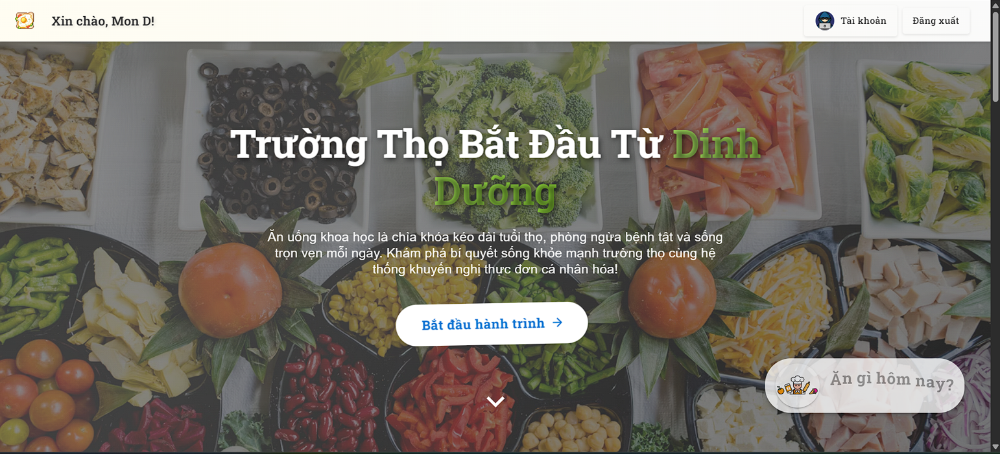
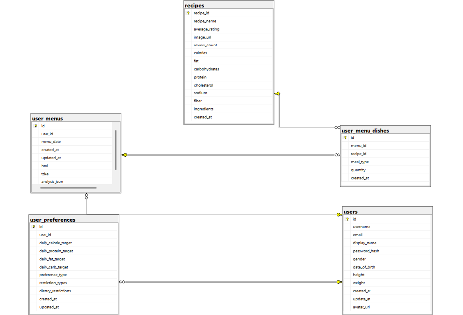

<div align="center">
  
  # NutriPlan
  **Data-Driven Diet Recommendation Platform**

  <p>
    Hệ thống nền tảng y tế sức khỏe hỗ trợ tạo lập thực đơn dinh dưỡng cá nhân hóa, <br>
    được kiến trúc dựa trên công thức lâm sàng Mifflin-St Jeor và thuật toán phân bổ tỷ lệ đa lượng/vi lượng từ cơ sở dữ liệu USDA.
  </p>

  [Live Demo](#)

</div>

---

## Table of Contents
- [Home page](#home-page)
- [Features](#features)
- [Tech Stack](#tech-stack)
- [Quick Start](#quick-start)
- [Data](#data)


## Home page

<p align="center">

  

</p>
<p align="center">
  <i>i'll update Gif how to use when i have time xD</i>
</p>

---

## Features

- **Phân tích Chỉ số Trao đổi chất:** Tự động tính toán BMI, BMR, và TDEE dựa trên công thức chuẩn y khoa *Mifflin-St Jeor*, điều chỉnh linh hoạt lượng Calo theo mục tiêu cân nặng (Giảm/Duy trì/Tăng).
- **Thuật toán Phân bổ Dinh dưỡng:** Xử lý và phân bổ chính xác tỷ lệ Đa lượng (Macronutrients: Protein, Carbs, Fat) và thiết lập ngưỡng an toàn cho Vi lượng (Micronutrients: Sodium, Fiber, Cholesterol) cho từng bữa ăn.
- **Gợi ý Thực đơn Tự động:** Truy vấn và kết hợp các công thức nấu ăn từ cơ sở dữ liệu để tạo ra lộ trình ăn uống cá nhân hóa, đáp ứng khắt khe các tiêu chí năng lượng và giới hạn bệnh lý của người dùng.
- **Bảo mật & Quản lý Hồ sơ:** Tích hợp xác thực JWT phi trạng thái (Stateless), lưu trữ an toàn hồ sơ sức khỏe, sở thích ăn uống và lịch sử thực đơn cá nhân.

## Tech Stack

| Layer | Technologies |
| --- | --- |
| **Frontend** | ReactJS, CSS/Tailwind, Axios |
| **Backend** | Python, Flask, Flask-JWT-Extended |
| **Database** | Microsoft SQL Server (T-SQL) |
| **Architecture** | 3-Tier Architecture, RESTful API |
| **Tools** | SQL Server Management Studio (SSMS), Postman |

## Quick Start

<details>
<summary><b>1. Khởi chạy Backend (Flask & SQL Server)</b></summary>
<br>

Đảm bảo bạn đã cài đặt SQL Server và thiết lập chuỗi kết nối (Connection String) trong code. Di chuyển vào thư mục `backend` và thiết lập môi trường:

```bash
cd backend
python -m venv venv
source venv/bin/activate  # Hoặc: venv\Scripts\activate trên Windows
pip install -r requirements.txt
cp .env.example .env
```

Cấu hình file `.env` với thông tin Database SQL Server và JWT Secret Key của bạn. Sau đó khởi chạy:

```bash
flask run
# Hoặc: python app.py
```
</details>

<details>
<summary><b>2. Khởi chạy Frontend (React)</b></summary>
<br>

Mở một Terminal mới, di chuyển vào `frontend`:

```bash
cd frontend
npm install
cp .env.example .env
```

Trỏ `REACT_APP_API_URL` (hoặc `VITE_API_URL`) về localhost của Flask trong file `.env` và chạy:

```bash
npm start
# Hoặc: npm run dev (nếu dùng Vite)
```
</details>

## Data

Dữ liệu của hệ thống được tổng hợp và chuẩn hóa từ các nguồn dữ liệu uy tín:
- **Cơ sở dữ liệu USDA** (United States Department of Agriculture) cho các công thức và thành phần món ăn chuẩn quốc tế.
- **Bảng thành phần thực phẩm Việt Nam** (Viện Dinh dưỡng - Bộ Y tế, 2007) để tối ưu hóa thuật toán cho đối tượng người dùng Châu Á.

<p align="center">
  
</p>

Hệ thống quản lý dữ liệu thông qua cấu trúc quan hệ chặt chẽ (RDBMS) với các bảng cốt lõi: `Users`, `UserPreferences`, `Recipes`, `UserMenus`, và `UserMenuDishes`.

---
<div align="center">
  <p><i>- algernon -</i></p>
</div>